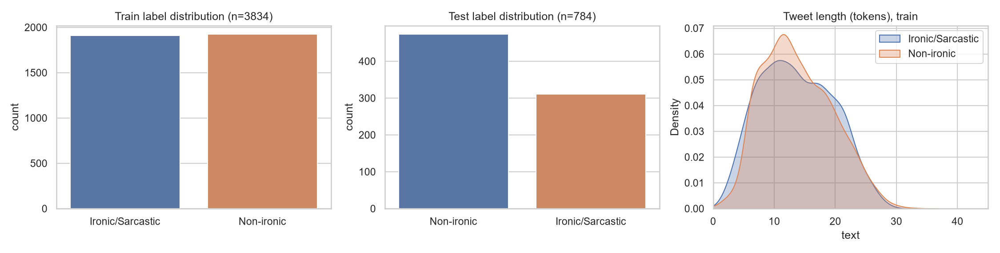
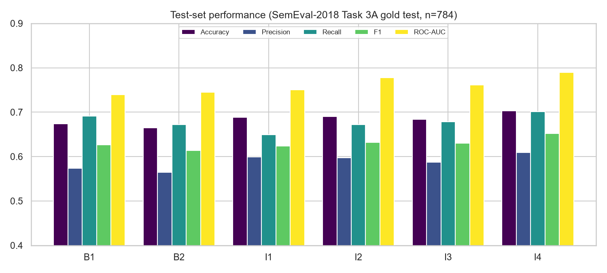
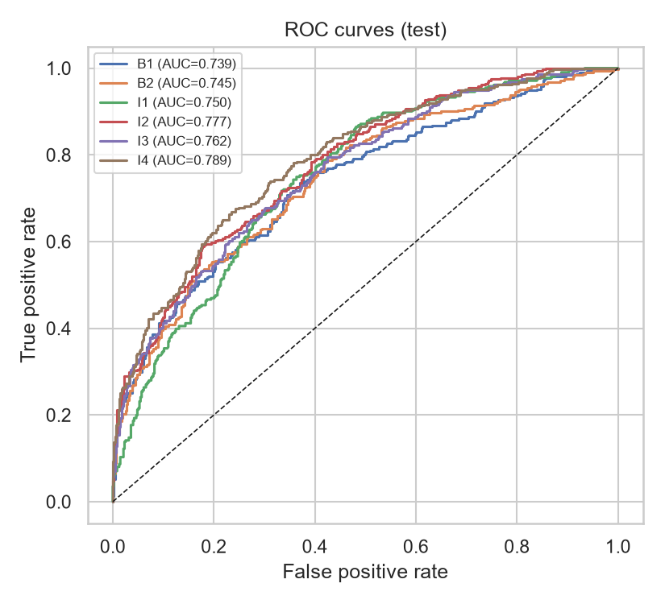
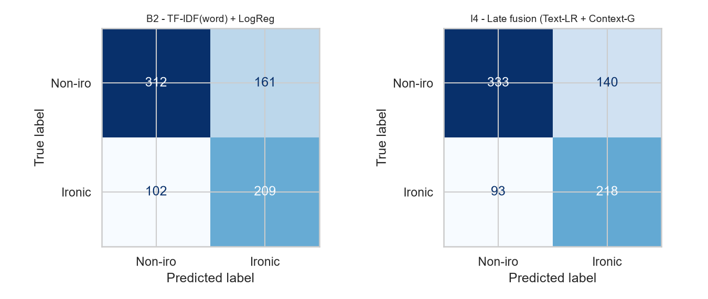
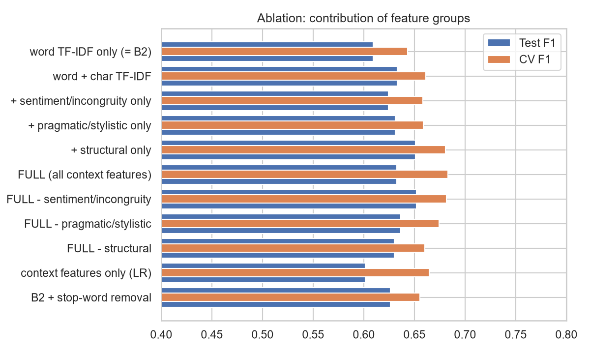
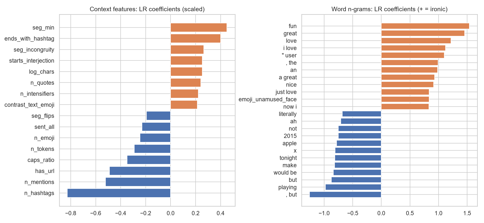
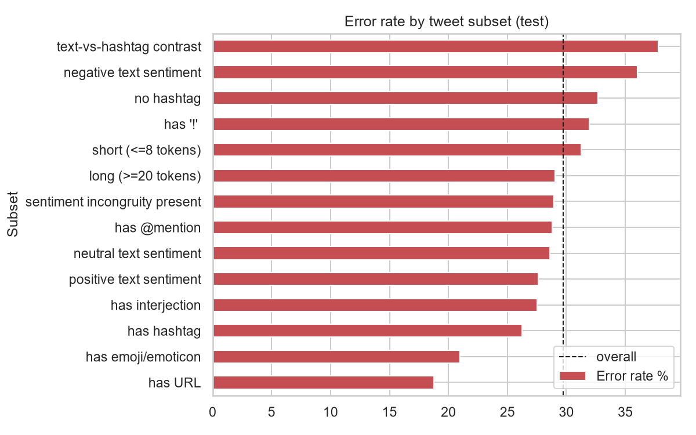

# 1. Problem Definition

Sarcasm is a form of figurative language in which the literal meaning of an utterance differs from, and often opposes, the intended meaning ("I *love* waking up at 5 am to a flat tyre"). It breaks sentiment analysis, opinion mining and dialogue systems, because the surface sentiment is the opposite of the real one. Detecting it in social media is hard: texts are short, noisy and full of hashtags, emoji and slang, and the cue that reveals sarcasm is usually *context* (a contradicting situation, hashtag or emoji) rather than any single word.

**Task.** Given a tweet, classify it as *ironic/sarcastic* (1) or *not* (0).

**Hypothesis.** A classifier that explicitly models contextual signals - sentiment incongruity between parts of the tweet, text-vs-hashtag and text-vs-emoji contrast, and pragmatic cues - will outperform a plain bag-of-words baseline.

**Scope note on "context".** The chosen dataset provides isolated tweets with no reply thread, so "context" here means *intra-tweet* context (clauses, hashtags, emoji, structure). Conversational context (parent comments) is discussed as future work.

# 2. Methodology Overview

Workflow: Problem definition -> Dataset -> Preprocessing -> Feature representation -> Baselines -> Improved methods -> Evaluation -> Comparison/Ablation -> Error analysis -> Conclusion -> Future scope.

* **Baselines:** B1 TF-IDF(word 1-2 grams) + Multinomial Naive Bayes; B2 TF-IDF(word) + Logistic Regression.
* **Improved:** I1 context features only + Gradient Boosting; I2 TF-IDF(word+char) + context features + Logistic Regression; I3 same features + Linear SVM; I4 late fusion (average of text-LR and context-gradient-boosting probabilities, weight 0.6/0.4).
* **Protocol:** hyper-parameters tuned by 5-fold stratified CV on the training set (scoring = F1 of the positive class); the tuned model is refit on the whole training set and evaluated once on the official gold test set. Ablations use the same protocol. All code is deterministic (seed 42).

# 3. Dataset

| Property | Value |
|---|---|
| Name | SemEval-2018 Task 3, Subtask A - Irony detection in English tweets |
| Source | https://github.com/Cyvhee/SemEval2018-Task3 (Van Hee, Lefever & Hoste, 2018) |
| Files used | `train/SemEval2018-T3-train-taskA_emoji.txt`, `goldtest_TaskA/SemEval2018-T3_gold_test_taskA_emoji.txt` |
| Collection | Tweets gathered via hashtags #irony, #sarcasm, #not (ironic class), plus non-ironic tweets; manually annotated. |
| Labels | 1 = ironic (includes sarcasm), 0 = not ironic |

**Table 1 - Dataset characteristics** (computed by `src/data.py`)

| | Train | Test |
|---|---:|---:|
| Tweets | 3,834 | 784 |
| Ironic / sarcastic (1) | 1,911 (49.8%) | 311 (39.7%) |
| Non-ironic (0) | 1,923 | 473 |
| Avg. characters | 87.4 | 94.4 |
| Avg. tokens | 13.7 | 14.9 |
| Raw vocabulary | 17,068 | 5,034 |
| % with hashtag | 39.6 | 72.2 |
| % with @mention | 39.9 | 37.6 |
| % with URL | 22.4 | 25.1 |
| % with emoji | 10.6 | 11.2 |



**Dataset caveats discovered during the project (important for interpreting results):**

1. *Irony vs. sarcasm.* Labels are for irony; sarcasm is its most frequent sub-type but not the only one (situational irony is also included).
2. *Label-leaking hashtags.* In the gold test file **all 311 ironic tweets still contain a collection hashtag** (#irony, #not, ...), and 120 non-ironic tweets contain one too. The training file has none (organisers removed them). A model could trivially exploit these on the test set, so the pipeline **masks** #sarcasm/#sarcastic/#irony/#ironic/#not/#sarcasmalert/#satire in both splits. The reported scores are therefore "content-only" scores.
3. *Train/test mismatch (found and fixed).* A first run used the emoji-stripped training file (0.1% emoji) against the test file (11% emoji). The emoji-preserving training file (10.6%) is used for all reported results.
4. *Distribution shift.* The test set has a different class prior (39.7% vs 49.8% ironic) and more hashtags (72% vs 40% of tweets).
5. *Collection artefacts.* After masking, ironic tweets contain fewer hashtags (train 0.67 vs 1.25 per tweet) and fewer URLs (14% vs 31%) than non-ironic ones. This is partly genuine (news-link tweets are rarely ironic) but plausibly also an artefact of how the corpus was built; see Sections 8-9.

# 4. Preprocessing (`src/preprocess.py`)

1. HTML unescape; `||` (this corpus' line-break marker) -> sentence break.
2. Mask label-leaking hashtags (see above).
3. URL -> `url`; @mention -> `user`.
4. Hashtag segmentation (`#NoReligion` -> `no religion`). Hashtags are *kept* as words because they often carry the situational context.
5. Emoji -> text tokens (`emoji_unamused_face`) with the `emoji` library.
6. Lower-casing and elongation normalisation (`soooo` -> `soo`); the elongation itself is kept as a feature.
7. Regex tokenisation that preserves emoticons (`;)`), punctuation runs (`!!!`, `...`, `?!`) and contractions.

Stop-words are kept by default because words such as *so, just, oh, really* are sarcasm markers; an ablation tests this choice (Section 7). Stemming/lemmatisation was not used (no WordNet access in the build environment; char n-grams partly compensate for morphology).

# 5. Feature Representation

| Representation | Details |
|---|---|
| Word TF-IDF | uni+bi-grams, min_df=2, sublinear TF |
| Char TF-IDF | `char_wb` 2-5 grams, min_df=3, sublinear TF |
| **Contextual features (34)** | standardised, clipped to [-5,5], weighted by a tuned block weight |

**Contextual feature groups** (`src/features.py`):

* **Sentiment context / incongruity (15):** VADER compound polarity of the whole text, hashtags and emoji; clause-level polarity (clauses split on punctuation and *but/however/though/yet*) with max, min, flip count and an incongruity score; counts of positive and negative lexicon words; flags for text-vs-hashtag and text-vs-emoji polarity contrast; "positive text + negative context" flag. Un-segmented hashtags (`#worstmorning`) are scanned for lexicon words.
* **Pragmatic / stylistic (12):** counts of `!`, `?`, `?!`, ellipses, quotation marks, ALL-CAPS words, caps ratio, elongated words, interjections (*oh, wow, yay*), intensifiers (*so, totally, absolutely*), laughter, starts-with-interjection.
* **Structural (8):** token count, length, number of hashtags, ends-with-hashtag, mentions, URL presence, emoji count, emoji-at-end.

# 6. Results

Metrics are for the positive (ironic) class unless noted. Test set n = 784. "CV F1" is 5-fold CV on the training set. F1 95% CI is a bootstrap (1,000 resamples) of the test set.

**Table 2 - Model comparison on the gold test set**

| Model | Acc | Prec | Rec | F1 | Macro-F1 | ROC-AUC | F1 95% CI | CV F1 |
|---|---:|---:|---:|---:|---:|---:|---|---:|
| B1 TF-IDF + Naive Bayes | 0.6735 | 0.5733 | 0.6913 | 0.6268 | 0.6683 | 0.7390 | [0.583, 0.669] | 0.6369 |
| B2 TF-IDF + LogReg | 0.6645 | 0.5649 | 0.6720 | 0.6138 | 0.6586 | 0.7453 | [0.568, 0.652] | 0.6465 |
| I1 Context-only + GradBoost | 0.6888 | 0.5994 | 0.6495 | 0.6235 | 0.6791 | 0.7501 | [0.578, 0.666] | 0.6652 |
| I2 Word+Char+Context + LogReg | 0.6901 | 0.5971 | 0.6720 | 0.6324 | 0.6822 | 0.7773 | [0.588, 0.675] | 0.6832 |
| I3 Word+Char+Context + LinearSVM | 0.6837 | 0.5877 | 0.6785 | 0.6299 | 0.6768 | 0.7615 | [0.586, 0.672] | 0.6806 |
| **I4 Late fusion (Text-LR + Context-GB)** | **0.7028** | **0.6089** | **0.7010** | **0.6517** | **0.6963** | **0.7894** | [0.610, 0.691] | **0.6829** |

Selected hyper-parameters: B1 alpha=1.0; B2 C=3; I1 depth=3, 200 iterations; I2 C=1, context weight 0.6; I3 C=0.03, context weight 0.15; I4 text-LR C=1, fusion weight 0.6 (fixed a priori, not tuned).



{ width=60% }



**Table 3 - Paired significance vs. baseline B2 (exact McNemar test on test predictions)**

| Model | B2 right / model wrong | B2 wrong / model right | p-value |
|---|---:|---:|---:|
| B1 NB | 42 | 49 | 0.530 |
| I1 Context-only GB | 109 | 128 | 0.242 |
| I2 Word+Char+Context LR | 55 | 75 | 0.095 |
| I3 Word+Char+Context SVM | 74 | 89 | 0.273 |
| **I4 Late fusion** | 46 | 76 | **0.008** |

**Comparative analysis.**

* Every improved model beats B2 in cross-validation (0.665-0.683 vs 0.647 F1, a gain of about 0.02-0.04 with fold standard deviations of about 0.012-0.016) and in ROC-AUC (0.750-0.789 vs 0.745).
* On the test set, the best model I4 improves F1 from 0.614 (B2) to 0.652 (+0.038) and accuracy from 66.4% to 70.3%. This is the only improvement that is statistically significant at the 5% level (McNemar p = 0.008). I2 is borderline (p = 0.095), and I1/I3 are not significant.
* The simpler Naive Bayes baseline (F1 0.627) is stronger than LogReg on the test set, so the improvement over the *best* baseline is +0.025 F1; I did not run a paired test against B1. Bootstrap intervals of different models overlap heavily, so differences of ~0.01-0.02 F1 should be treated as noise.
* Context features alone (I1, no text at all) reach 0.624 test F1 / 0.665 CV F1, about the same as the word-TF-IDF baseline. The contextual cues carry real signal that is largely *complementary* to lexical content, which is why late fusion works best.
* Precision stays low (0.56-0.61) for all systems: the models over-predict irony (140 false positives vs. 93 false negatives for I4).
* For orientation only: the SemEval-2018 task overview reports best participant F1 around 0.70 for deep-learning systems. That number is **not directly comparable** because of differences in the test file and my masking of label hashtags.

# 7. Ablation Study

All rows use the I2 configuration (LogReg, C=1, context weight 0.6). Ablation rows were computed with the same CV/test protocol.

**Table 4 - Ablation**

| Configuration | CV F1 (mean ± std) | Test Acc | Test P | Test R | Test F1 |
|---|---|---:|---:|---:|---:|
| Word TF-IDF only | 0.6431 ± 0.016 | 0.6633 | 0.5644 | 0.6624 | 0.6095 |
| Word + char TF-IDF | 0.6610 ± 0.009 | 0.6837 | 0.5863 | 0.6881 | 0.6331 |
| + sentiment/incongruity only | 0.6581 ± 0.012 | 0.6773 | 0.5801 | 0.6752 | 0.6241 |
| + pragmatic/stylistic only | 0.6586 ± 0.011 | 0.6913 | 0.6000 | 0.6656 | 0.6311 |
| + structural only | 0.6805 ± 0.015 | 0.6977 | 0.6005 | 0.7106 | 0.6510 |
| FULL (all context features) | 0.6832 ± 0.016 | 0.6901 | 0.5971 | 0.6720 | 0.6324 |
| FULL - sentiment/incongruity | 0.6817 ± 0.017 | 0.7015 | 0.6066 | 0.7042 | 0.6518 |
| FULL - pragmatic/stylistic | 0.6742 ± 0.013 | 0.6849 | 0.5870 | 0.6945 | 0.6362 |
| FULL - structural | 0.6604 ± 0.012 | 0.6888 | 0.5960 | 0.6688 | 0.6303 |
| Context features only (LR) | 0.6648 ± 0.016 | 0.6620 | 0.5650 | 0.6431 | 0.6015 |
| Word TF-IDF + stop-word removal | 0.6555 ± 0.011 | 0.6786 | 0.5813 | 0.6785 | 0.6261 |

{ width=80% }

**Findings.**

* Character n-grams help (+0.018 CV F1), consistent with the noisy, misspelled nature of tweets.
* The **structural** group provides the largest context gain (+0.020 CV F1 over word+char); removing it from the full model costs the most (CV 0.6832 -> 0.6604).
* The **sentiment-incongruity features did not help** in this experiment: adding them alone gives no CV gain (0.6581 vs 0.6610), and removing them from the full model leaves CV unchanged (0.6817 vs 0.6832) and *raises* test F1 (0.6518 vs 0.6324). The main hypothesis of the project - that explicit incongruity features add value - is therefore **not supported** by these data, although the test-set differences are within noise. Likely reasons: VADER is a general-purpose lexicon, not tuned for tweets' sarcasm; incongruity features fire rarely (only 38 of 784 test tweets have a clause-level incongruity); and sarcasm in this corpus is often situational rather than lexical.
* Removing stop-words did not hurt and gave a small gain (CV +0.012, about one standard deviation), so the stop-word design choice is not supported either; the effect is too small to be conclusive.

# 8. Feature Inspection



* Words most associated with irony: *fun, great, love, "i love", "just love", nice, thanks, so* and the unamused-face emoji - positive, enthusiastic vocabulary. Words associated with non-irony include *but, playing, tonight, would be, 2015*.
* Among context features, the strongest negative coefficients are `n_hashtags` (-0.83), `n_mentions` (-0.52), `has_url` (-0.49) and `caps_ratio` (-0.35); the strongest positive ones include `seg_min` (+0.45), `ends_with_hashtag` (+0.40), `seg_incongruity` (+0.27), `starts_interjection` (+0.25), `n_quotes` (+0.24) and `n_intensifiers` (+0.22).
* The strongest features are structural. As noted in Section 3, hashtag/URL/mention counts partly reflect how the corpus was assembled, so the model does not learn *only* sarcasm.

# 9. Error Analysis (best model I4)

Overall error rate 29.7% on the test set: 93 false negatives (missed irony; 29.9% of ironic tweets) and 140 false positives (false alarms; 29.6% of non-ironic tweets).

**Table 5 - Error rates by tweet subset** (`results/error_by_subset.csv`)

| Subset | n | % ironic | Error % | FN % (of ironic) | FP % (of non-ironic) |
|---|---:|---:|---:|---:|---:|
| Short (<=8 tokens) | 144 | 39.6 | 31.2 | 15.8 | 41.4 |
| Long (>=20 tokens) | 155 | 45.2 | 29.0 | 25.7 | 31.8 |
| Has hashtag | 362 | 38.4 | 26.2 | 24.5 | 27.4 |
| No hashtag | 422 | 40.8 | 32.7 | 34.3 | 31.6 |
| Has emoji/emoticon | 105 | 32.4 | 21.0 | 14.7 | 23.9 |
| Has URL | 197 | 19.8 | 18.8 | **79.5** | 3.8 |
| Has @mention | 295 | 28.5 | 28.8 | 56.0 | 18.0 |
| Positive text sentiment | 326 | 43.3 | 27.6 | 14.9 | **37.3** |
| Negative text sentiment | 161 | 34.2 | 36.0 | **47.3** | 30.2 |
| Neutral text sentiment | 297 | 38.7 | 28.6 | 40.0 | 21.4 |
| Sentiment incongruity present | 38 | 47.4 | 28.9 | 22.2 | 35.0 |
| Text-vs-hashtag contrast | 45 | 55.6 | 37.8 | 16.0 | 65.0 |

{ width=70% }

**Quantitative patterns.**

* *URL and @mention tweets are mostly predicted non-ironic.* 79.5% of ironic tweets that contain a URL are missed (the model has learned that link-sharing tweets are usually non-ironic).
* *Polarity bias.* Positive-sentiment tweets are over-flagged (37.3% of the non-ironic ones are false positives) while ironic tweets with negative or neutral surface sentiment are missed (47.3% and 40.0%). The model has largely learned "enthusiastic wording => ironic", the classic positive-sentiment cue, but not the subtler negative-text sarcasm.
* *Short tweets* produce many false alarms (41.4% FP): little evidence, so the prior on positive wording dominates.
* The text-vs-hashtag contrast group is small (n=45) and has 65% false positives, so a contrast between the main text and a hashtag is a poor indicator on its own here (many hashtags are merely playful or negative commentary on a neutral statement).

**Qualitative analysis** (read from the 8 most confident false negatives and 8 most confident false positives in `results/errors_test.csv`; this is a small, non-exhaustive sample):

| Type | Example | Likely reason |
|---|---|---|
| FN | "clashupdate #not http://..." ; "Produce Mobile Apps #not http://..." | The only sarcasm cue was the collection hashtag, which we mask by design; the rest is neutral link text. |
| FN | "...the mayor and Gov are Dems. #irony" ; "...the trickle down fairy will do the rest" | Needs world/political knowledge or a rhetorical reading; no lexical or sentiment cue. |
| FN | tweets with several @mentions and a URL | Structural prior (mentions/URLs => non-ironic) overrides weak textual evidence. |
| FP | "Corny jokes are my absolute favorite" ; "Yeah, you're a grown up... Life's handiwork!!" | Positive wording + intensifier, plausibly sincere or ambiguous without context. |
| FP | "How were your #holidays? We'd love to hear all about them!" | Brand-style tweet; a genuine model error (probability 0.72). |
| FP | "Dan said he's going to have a sign for me at the airport when I fly in lol #SoCute" | Probably sincere; may also reflect annotation noise or subjectivity. |

# 10. Limitations

1. **Single-tweet context only.** No conversational or author context; many sarcastic tweets cannot be identified without it, even by humans.
2. **Irony label, not pure sarcasm**, and the corpus is small (3.8k training tweets).
3. **Corpus artefacts.** The most influential features (hashtag, mention and URL counts) partly encode collection procedure; the model's performance may not transfer to other platforms or datasets. I did not evaluate cross-dataset generalisation.
4. **Shallow semantics.** TF-IDF and a general-purpose sentiment lexicon cannot capture world knowledge or compositional meaning; no pre-trained embeddings or transformers were used (no model-hub access in the build environment).
5. **Evaluation caveats.** One train/test split plus CV; the best model was chosen using test F1 (its CV F1, 0.683, is essentially tied with I2's 0.683, so CV alone would not separate them; this means the choice of I4 as "best" rests partly on test data); the late-fusion weight 0.6 was fixed, not tuned; differences between several models are within bootstrap noise; no multi-seed repetition. Test prior and hashtag rate differ from training data, and no threshold calibration was performed.
6. **Heuristic features.** VADER, the substring scan for un-segmented hashtags and the interjection/intensifier lists are hand-built and imperfect.
7. **Label subjectivity.** Some "errors" are arguably annotation noise; inter-annotator agreement on irony is only moderate.

# 11. Conclusions

* A realistic NLP pipeline (tweet-specific preprocessing, word+char TF-IDF, 34 contextual features) was implemented and compared against two baselines under a rigorous protocol (tuned CV, held-out gold test, bootstrap CIs, McNemar, ablation).
* Adding contextual features improved F1 from 0.614 to 0.632-0.652 on the test set and from 0.647 to 0.665-0.683 in cross-validation. The best system - late fusion of a text model and a context model - reached **F1 = 0.652, accuracy = 70.3%, ROC-AUC = 0.789**, and is the only improvement that is statistically significant against the baseline (p = 0.008).
* The gain comes mainly from structural and pragmatic context and from character n-grams; the *sentiment-incongruity* features, which motivated the project, did not give a measurable benefit with a general-purpose lexicon.
* Errors are dominated by (i) ironic tweets whose cue is world knowledge or the masked hashtag, and (ii) sincere positive tweets flagged as ironic.

# 12. Possible Improvements and Research Directions

1. **Contextual language models.** Fine-tune a tweet-specific transformer (e.g. BERTweet/RoBERTa) and fuse it with the contextual features (concatenate or late-fuse), which my result suggests are complementary to lexical content.
2. **Learned incongruity instead of lexicon incongruity.** Train a model to compare the *sentiment expression* with the *situation* it describes (following Riloff et al., 2013), e.g. with embeddings or NLI-style sentence-pair models, and a tweet-specific/sarcasm-specific lexicon mined from data.
3. **Real conversational context.** Evaluate on corpora with parent comments/threads (e.g. SARC, Khodak et al., 2018) and measure the benefit of thread and author context directly. Research question: *how much does context add beyond the target text, and for which sarcasm types?*
4. **De-biasing.** Repeat the study with structural features removed or with adversarial/reweighted training to test whether performance holds when collection artefacts are neutralised, and test cross-dataset transfer.
5. **Evaluation robustness.** Multi-seed repeated CV, threshold/prior calibration for the shifted test distribution, and paired tests against the strongest baseline.
6. **Knowledge-aware detection.** Retrieval of external knowledge for situational irony ("Gov are Dems"-style political irony) and multimodal cues for tweets with images.

# 13. Reproducibility

```
pip install -r requirements.txt
python run_all.py          # ~5 min on 1 CPU; writes results/ and results/figures/
python predict.py "Oh great, another Monday morning meeting!"
```
Python 3.12, scikit-learn 1.8, pandas, vaderSentiment 3.3, emoji 2.16. Seed 42. Gradient-boosting models (I1, I4) can differ in the third decimal across machines or library versions (an earlier run in a different environment gave I4 F1 = 0.658, p = 0.005); all other models and the ablation reproduced exactly. The numbers in this report come from a Windows run (Python 3.13) and match `results/*.csv` produced by `run_all.py`. All numbers in this report are from `results/*.csv` and `results/run_log.txt` generated by `run_all.py`.

# 14. References

1. Van Hee, C., Lefever, E., & Hoste, V. (2018). SemEval-2018 Task 3: Irony Detection in English Tweets. *Proceedings of the 12th International Workshop on Semantic Evaluation (SemEval-2018)*, pp. 39-50. ACL.
2. Hutto, C. J., & Gilbert, E. (2014). VADER: A Parsimonious Rule-based Model for Sentiment Analysis of Social Media Text. *Proc. ICWSM*.
3. Riloff, E., Qadir, A., Surve, P., De Silva, L., Gilbert, N., & Huang, R. (2013). Sarcasm as Contrast between a Positive Sentiment and Negative Situation. *Proc. EMNLP*.
4. Gonzalez-Ibanez, R., Muresan, S., & Wacholder, N. (2011). Identifying Sarcasm in Twitter: A Closer Look. *Proc. ACL (short papers)*.
5. Joshi, A., Bhattacharyya, P., & Carman, M. J. (2017). Automatic Sarcasm Detection: A Survey. *ACM Computing Surveys*, 50(5).
6. Khodak, M., Saunshi, N., & Vodrahalli, K. (2018). A Large Self-Annotated Corpus for Sarcasm (SARC). *Proc. LREC*.
7. Davidov, D., Tsur, O., & Rappoport, A. (2010). Semi-Supervised Recognition of Sarcastic Sentences in Twitter and Amazon. *Proc. CoNLL*.
8. Dietterich, T. G. (1998). Approximate Statistical Tests for Comparing Supervised Classification Learning Algorithms. *Neural Computation*, 10(7).
9. Pedregosa, F. et al. (2011). Scikit-learn: Machine Learning in Python. *JMLR*, 12.
10. Nguyen, D. Q., Vu, T., & Nguyen, A. T. (2020). BERTweet: A pre-trained language model for English Tweets. *Proc. EMNLP (Demos)*.
